# Convai Vision Assistant

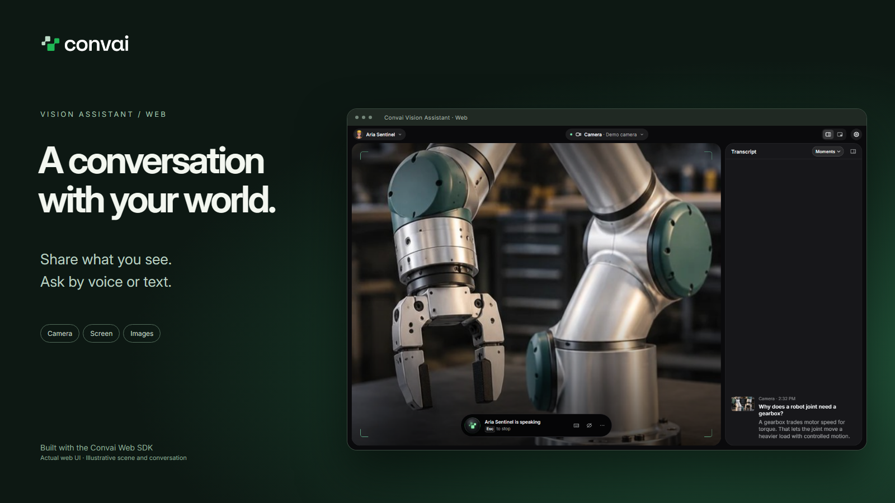

**A voice and vision assistant for your Convai characters.**

Share a camera, browser tab, window, screen, selected area, or image, then talk about what you see.
Ask questions by voice or text, follow up naturally, and switch between the characters in your account.

Built with the public [Convai Web SDK](https://docs.convai.com/api-docs/plugins-and-integrations/web-plugins/convai-web-sdk).
Run it locally with your own API key, or use the included server integration to host your own instance.

[Get started](#get-started) · [Use the assistant](#use-the-assistant) · [Configuration](#configuration) · [Deploy](#deploy) · [Contribute](CONTRIBUTING.md)

> **Pre-release:** the first public release is being prepared. See [CHANGELOG.md](CHANGELOG.md).

## Features

- **Share visual context.** Show your camera, a tab, a window, your screen, a selected area, or an image.
- **Talk or type.** Use push to talk, hands-free voice, or text messages.
- **Choose your character.** Characters load automatically from your Convai account. Select one in the app.
- **Follow the conversation.** Read captions and the transcript, mute the microphone, or pause visual sharing.
- **Keep the assistant nearby.** Use a floating window where Document Picture-in-Picture is available.
- **Adjust the interface.** Change text size, contrast, motion, and keyboard shortcuts in Settings.

The app connects to Convai over the internet. Running locally hosts the interface and app server on
your computer; AI responses are provided by Convai and depend on your character configuration.

## See it in action

Talk about a mechanism, type a follow-up, choose what to share, or switch to another character.
These screenshots show the actual web interface with staged visual inputs and illustrative replies.
The sample characters shown are examples; your character list comes from your own Convai account.

| Voice and vision                                                                                                                     | Type a follow-up                                                                                                                                         |
| ------------------------------------------------------------------------------------------------------------------------------------ | -------------------------------------------------------------------------------------------------------------------------------------------------------- |
| [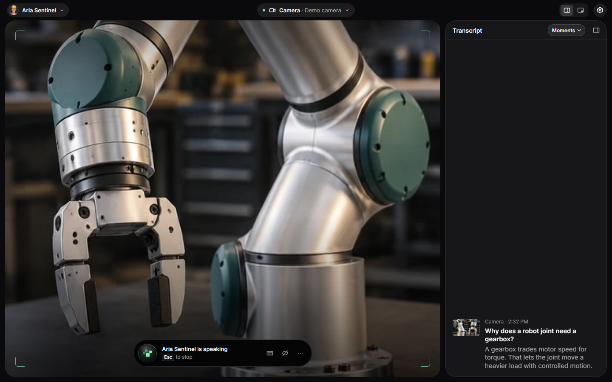](docs/media/01-conversation.png) | [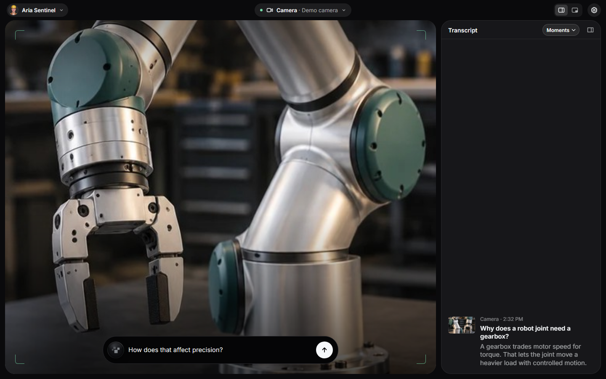](docs/media/02-type-and-follow-up.png)                             |
| **Choose what to share**                                                                                                             | **Choose your character**                                                                                                                                |
| [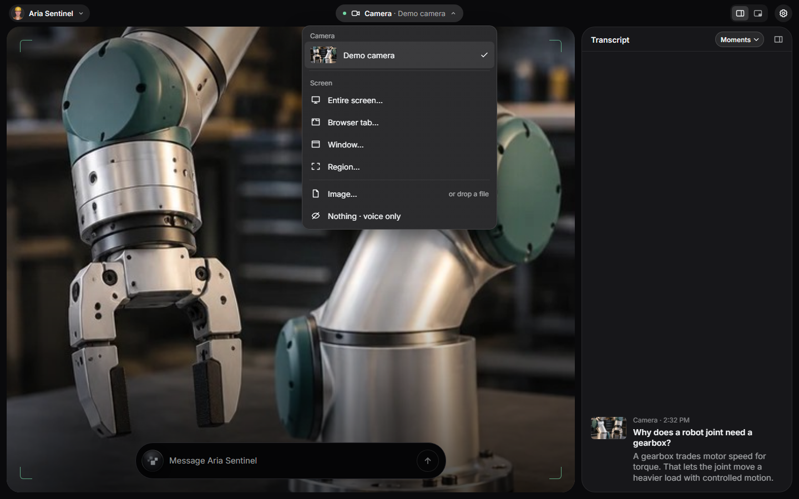](docs/media/03-visual-sources.png)                       | [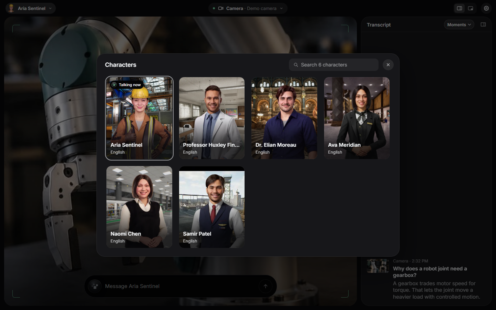](docs/media/04-characters.png)                           |
| **Make it yours**                                                                                                                    | **Explore an image**                                                                                                                                     |
| [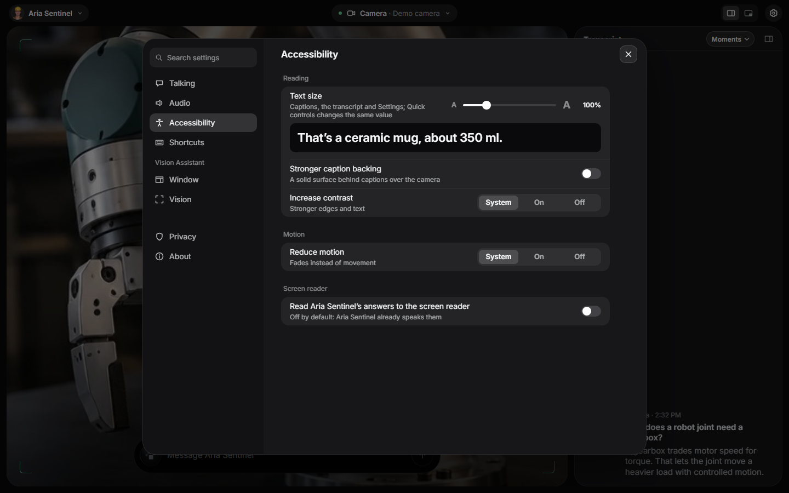](docs/media/05-settings.png)              | [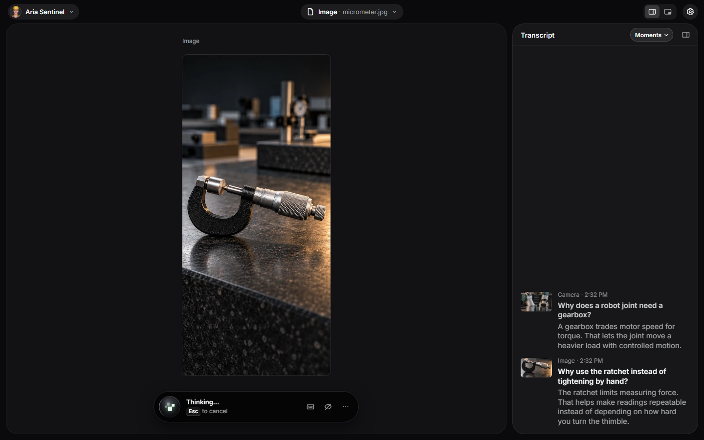](docs/media/06-image-and-transcript.png) |

Character cards and the [full character preview](docs/media/18-character-preview.png) are shown with
their configured background artwork. [Compare the two views](docs/media/character-overview.png).

### More ways to share

Camera and image examples appear above. These examples show the other four visual sources,
each with different illustrative content: a browser article, an analysis window, an energy workspace
and a selected section of an engineering drawing.

<details>
<summary>View browser tab, window, entire screen and selected-area examples</summary>

| Browser tab                                                                                                                                        | Window                                                                                                                                  |
| -------------------------------------------------------------------------------------------------------------------------------------------------- | --------------------------------------------------------------------------------------------------------------------------------------- |
| [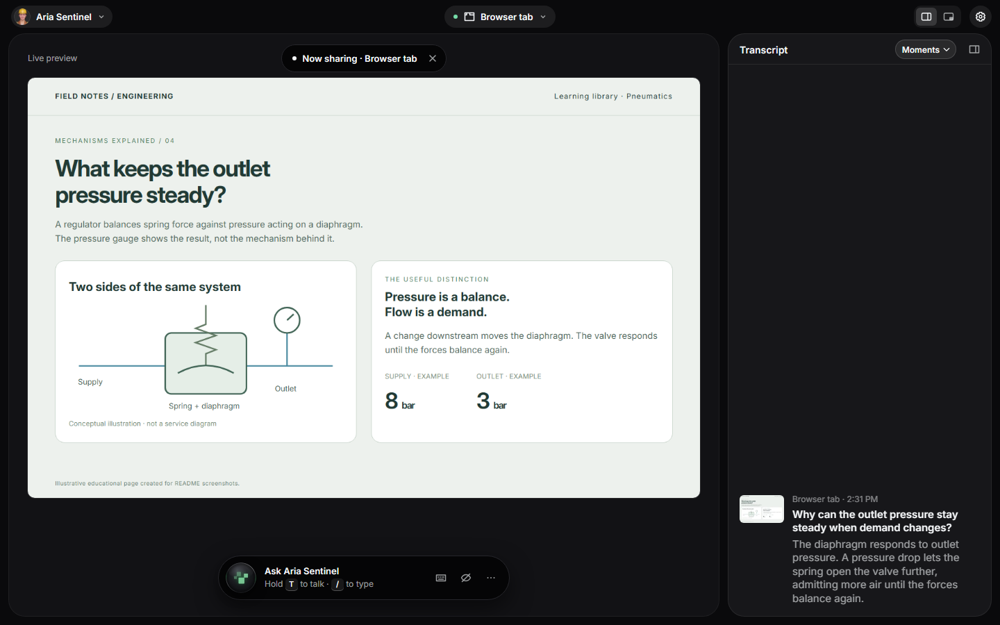](docs/media/07-browser-tab.png)                             | [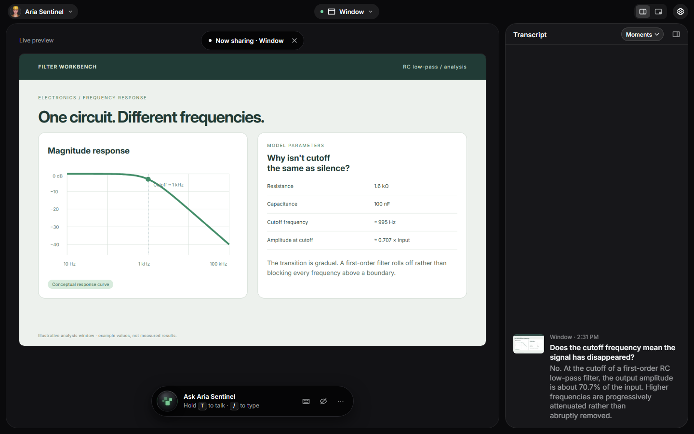](docs/media/08-window.png)         |
| **Entire screen**                                                                                                                                  | **Selected area**                                                                                                                       |
| [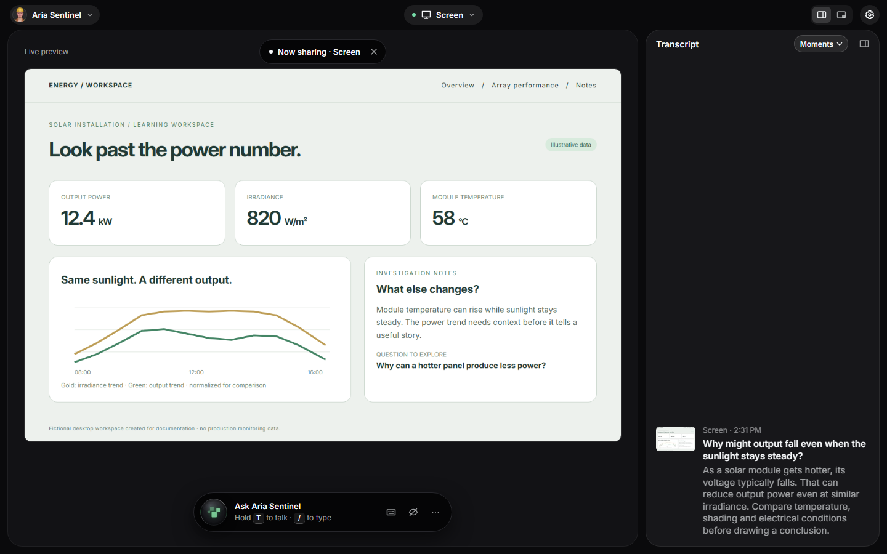](docs/media/09-entire-screen.png) | [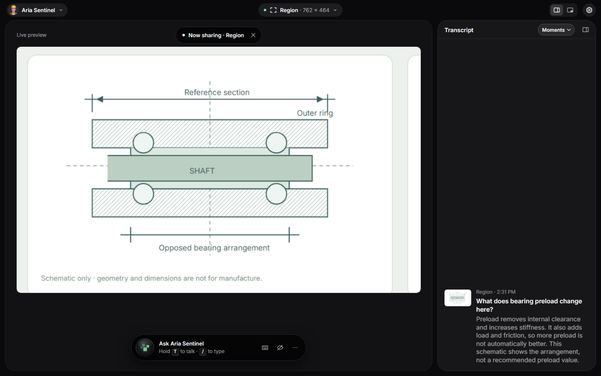](docs/media/10-selected-area.png) |

[See how an area is selected](docs/media/11-select-an-area.png) ·
[Compare all six visual sources](docs/media/sharing-overview.png)

</details>

### Follow the conversation your way

The same three-question discussion is shown in each transcript style. **Moments** pairs questions
with the visual context, **Continuum** fades the conversation in over the stage, and **Conversation**
uses chat bubbles in the panel. Choose all three in Settings; the panel's style menu offers Moments
and Conversation.

[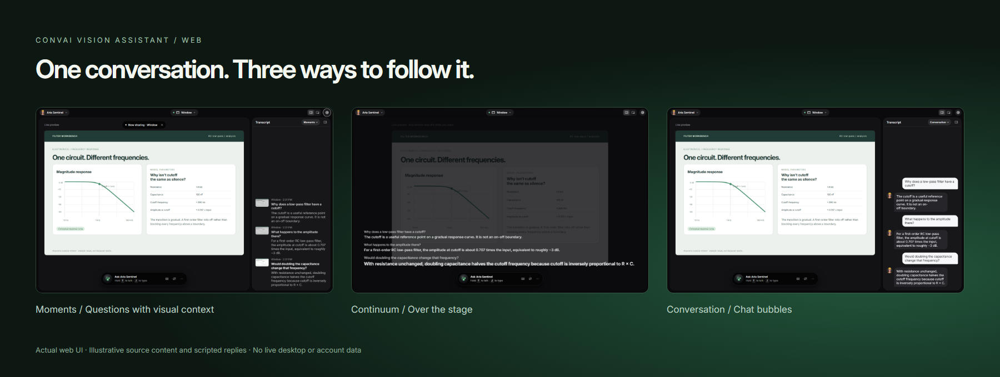](docs/media/transcript-comparison.png)

[Moments](docs/media/12-transcript-moments.png) ·
[Continuum](docs/media/13-transcript-continuum.png) ·
[Conversation](docs/media/14-transcript-conversation.png) ·
[Layout settings](docs/media/17-transcript-choices.png)

You can also [open Quick controls](docs/media/15-quick-controls.png) or
[continue with voice and text without sharing visuals](docs/media/16-voice-only.png).

Click an image to view it at full size, or open the [application overview](docs/media/overview.png).
For capture details and the GitHub social-preview asset,
see [the media guide](docs/media/README.md).

## Get started

You need a [Convai account](https://convai.com/), an API key, and at least one character in that account.
**The API key is the only account setting required.** The app loads your characters automatically;
you do not need to find, copy, or configure character IDs.

### With an AI coding assistant

Download the repository and open its folder in your coding assistant. Ask:

> Read AGENTS.md, set up this project locally, help me add my Convai API key, and open the app in my browser.

[AGENTS.md](AGENTS.md) guides the assistant through prerequisites, installation, API key setup, and
starting the local server. Enter your key in `.env.local` when instructed, **not in chat**.
The assistant should give you the browser address and keep the server running while you try the app.

### Manual setup

#### 1. Check the prerequisites

| Requirement | Details                                              |
| ----------- | ---------------------------------------------------- |
| Node.js     | 22.18 or newer                                       |
| pnpm        | 10.17.1, pinned in `package.json`                    |
| Browser     | Desktop Chrome or Edge recommended                   |
| Devices     | Microphone for voice; camera only for camera sharing |

Install [Node.js](https://nodejs.org/en/download) if needed. To clone the repository, also install
[Git](https://git-scm.com/downloads). Downloading and extracting the repository ZIP is an alternative.

#### 2. Install the project

Download or clone this repository. If you downloaded a ZIP, extract it first. Open PowerShell on
Windows, or Terminal on macOS/Linux, in the project folder—the folder containing `package.json`.

```sh
corepack enable
pnpm install --frozen-lockfile
```

If Corepack is unavailable or cannot enable pnpm, install the pinned version with
`npm install --global pnpm@10.17.1`, then run `pnpm install --frozen-lockfile`.

#### 3. Add your API key

Create `.env.local` from the example. These commands preserve an existing configuration file.

**macOS / Linux**

```sh
[ -e .env.local ] || cp .env.example .env.local
```

**Windows PowerShell**

```powershell
if (-not (Test-Path -LiteralPath .env.local)) { Copy-Item .env.example .env.local }
```

Open `.env.local` in a plain-text editor; on Windows, use `notepad .env.local`. Add your key:

```dotenv
CONVAI_API_KEY=your_api_key
```

Your key is available in your Convai account dashboard. If the account has no characters, create one
before continuing. The [Web SDK quickstart](https://docs.convai.com/api-docs/plugins-and-integrations/web-plugins/convai-web-sdk/quickstart)
provides background on Convai accounts and characters; this app handles character discovery for you.

Save the file as `.env.local`, not `.env.local.txt`. Git ignores it. Keep the variable name exactly
as shown: a `VITE_` prefix would expose the value to browser code.

#### 4. Start the app

```sh
pnpm dev
```

Open the address printed in the terminal, usually [http://localhost:5173](http://localhost:5173).
Complete the welcome flow, choose how you want to talk, and start the conversation.
The app uses your previous character selection when available, or the first character in your account.
Use the character picker to choose another.

Keep the terminal running. Press **Ctrl+C** to stop the app. To start it again, open a terminal in
the project folder and run `pnpm dev`. Restart the server after changing `.env.local`.

## Use the assistant

1. **Choose what to share.** Select a visual source in the app and confirm access in your browser.
2. **Ask a question.** Hold **T** in push-to-talk mode, use hands-free mode, or open the text field with **/**.
3. **Continue the conversation.** Ask a follow-up, switch sources, or choose another character.
4. **Control sharing.** Pause vision or mute the microphone whenever you need to.

Hands-free mode keeps the microphone active while enabled and permitted. Camera and screen capture
require browser permission. The app sends the visual source you share to Convai for the conversation.
Pausing vision stops new visual content from being sent; it does not erase earlier conversation context.

### Keyboard shortcuts

These are the defaults. Change supported shortcuts in **Settings → Shortcuts**. Single-key shortcuts
work while the app has focus and you are not typing, except where noted.

| Shortcut            | Action                                                  |
| ------------------- | ------------------------------------------------------- |
| Hold T              | Talk in push-to-talk mode; release to send              |
| Shift+T             | Toggle hands-free mode; follows the configured talk key |
| /                   | Open the message field                                  |
| Enter / Shift+Enter | Send a typed message / insert a newline                 |
| M                   | Mute or unmute the microphone                           |
| R                   | Show or hide the transcript                             |
| Q                   | Open quick controls                                     |
| Ctrl+,              | Open Settings                                           |
| Alt+V               | Pause or resume vision; also works in text fields       |
| Ctrl+K              | Open the character picker; also works in text fields    |
| Esc                 | Close the active overlay or stop a reply                |

On macOS, use **Command** for Ctrl shortcuts and **Option+V** for Alt+V. Browser support varies for
capture and floating windows. A single-character account shows character information instead of a
multi-character picker.

## Configuration

For local use, set the following in `.env.local`. For hosting, use the server environment.

| Variable             | Required | Purpose                                                                |
| -------------------- | -------- | ---------------------------------------------------------------------- |
| `CONVAI_API_KEY`     | Yes      | Server-side API key for the account whose characters appear in the app |
| `CONVAI_END_USER_ID` | No       | Conversation memory identity; defaults to `vision-assistant-web-dev`   |
| `PORT`               | No       | Production Node server port; defaults to 3000, or 8080 in Docker       |

`CONVAI_END_USER_ID` identifies the person speaking for long-term memory. It does not select a character
and can be left unset for local use. All sessions of one deployment share this identity. Applications
with multiple users should derive a stable identity from their own authentication system.

Your selected character and interface preferences are remembered in this browser when local storage
is available.

### How credentials work

The app server uses your API key to load account characters through the public
[Character List API](https://docs.convai.com/api-docs/api-reference/core-api-reference/character-crafting-apis/character-list-api)
and create short-lived connection tokens. The browser receives character metadata and a token;
the API key stays on the server.

| App route             | Purpose                                            |
| --------------------- | -------------------------------------------------- |
| `GET /api/characters` | Load the characters available to select            |
| `GET /api/token`      | Obtain a short-lived token for a Convai connection |

The browser connects to the selected character with the token, using the public Convai Web SDK.
See [Connect with an auth token](https://docs.convai.com/api-docs/plugins-and-integrations/web-plugins/convai-web-sdk/auth-tokens)
for the underlying SDK flow.

## Deploy

Hosting is optional. The app needs a server for its API routes; static hosting alone is insufficient.

**Before sharing a deployment:** anyone who can reach its token endpoint can use the configured
Convai account. This starter does not include visitor authentication or rate limiting. Add access
controls and rate limits for your audience. Usage is associated with the configured account, and
sessions share its conversation memory identity unless you extend the server.

Use HTTPS for remote hosting. Microphone, camera, and screen capture require a secure context;
`http://localhost` works for local development.

### Node.js

```sh
pnpm install --frozen-lockfile
pnpm build
pnpm start
```

The server serves the production build and API routes at [http://localhost:3000](http://localhost:3000).
It reads `.env.local` when present. Set `PORT` if needed and use an HTTPS reverse proxy for remote hosting.

`pnpm preview` serves static assets without the API routes. Use `pnpm start` to try the complete
production application.

### Docker

```sh
docker build -t convai-vision-assistant .
docker run --rm --env-file .env.local -p 8080:8080 convai-vision-assistant
```

Open [http://localhost:8080](http://localhost:8080). The container runs as a non-root user. Credentials
are excluded from the image and supplied at runtime. Use an HTTPS reverse proxy for remote hosting.

### Vercel

1. Import your copy of this repository.
2. Use `pnpm build` as the build command and `dist` as the output directory.
3. Set `CONVAI_API_KEY` as a server environment variable.
4. Configure access protection for your audience and deploy.

`vercel.json` supplies the build configuration; `api/` supplies the server functions. Add credentials
to Preview environments only if those deployments should use your account. Redeploy after changing
server environment variables.

## Troubleshooting

| Problem                           | What to do                                                                                                       |
| --------------------------------- | ---------------------------------------------------------------------------------------------------------------- |
| `CONVAI_API_KEY is not set`       | Add your key to `.env.local`, save it, and restart `pnpm dev`. For hosting, set the server environment variable. |
| Convai refuses an API request     | Check the key, the account's access, and the reported HTTP status. Restart after changing local configuration.   |
| No characters available           | Create a character in the account associated with your key, then select **Reload characters**.                   |
| Loading characters takes too long | Check your network connection and select **Try again**.                                                          |
| Page opens but conversations fail | Use `pnpm dev` or `pnpm start`; static preview does not serve the API.                                           |
| Microphone or camera is blocked   | Allow access in browser site settings and check whether another app is using the device.                         |
| Sharing does not start            | Confirm a source in the browser picker and use HTTPS or localhost.                                               |
| Compact mode is unavailable       | Use a browser with Document Picture-in-Picture support, or stay in the full window.                              |
| Talk key does nothing             | Focus the app, leave the text field, and check your configured talk key.                                         |

When reporting a problem, include the app version, browser, operating system, and steps to reproduce it.
Keep API keys, auth tokens, private conversations, and unredacted network captures out of reports.
See [SECURITY.md](SECURITY.md) for private vulnerability reports.

## Development

```sh
pnpm typecheck
pnpm lint
pnpm format:check
pnpm test
pnpm exec playwright install chromium
pnpm e2e --project=chromium
```

Browser tests use fake media and a fake Convai transport. They require no API key, consume no Convai
usage, and do not replace a live conversation test. See [CONTRIBUTING.md](CONTRIBUTING.md) for browser
installation, test build behavior, production checks, and the contribution workflow.

`pnpm format` formats the source. `/gallery.html` displays the reusable interface components.
The CI configuration includes production credential checks, a bundle size budget, and a Docker smoke test.

### Repository layout

| Path               | Responsibility                                            |
| ------------------ | --------------------------------------------------------- |
| `src/app/`         | Application interface and interactions                    |
| `src/session/`     | Conversation state and Convai SDK transport               |
| `src/vision/`      | Camera, capture, images, and selected areas               |
| `src/characters/`  | Character lists, search, languages, and recent selections |
| `src/credentials/` | Browser requests to the app server                        |
| `src/kit/`         | Reusable interface components and styles                  |
| `server/`          | Shared API handlers and the production Node server        |
| `api/`             | Vercel function adapters                                  |
| `e2e/`             | Playwright browser tests                                  |
| `scripts/`         | Build, license, and bundle checks                         |
| `AGENTS.md`        | Setup and development instructions for coding assistants  |

## Contributing, security, and license

Read [CONTRIBUTING.md](CONTRIBUTING.md) before opening a pull request and follow the
[Code of Conduct](CODE_OF_CONDUCT.md). Report vulnerabilities privately using [SECURITY.md](SECURITY.md).

Licensed under [Apache License 2.0](LICENSE). Copyright 2026 Convai Technologies Inc.
See [NOTICE](NOTICE) for attribution and `src/kit/fonts/OFL.txt` for the Inter font license.
Production builds include dependency license notices in **Settings → About**.
